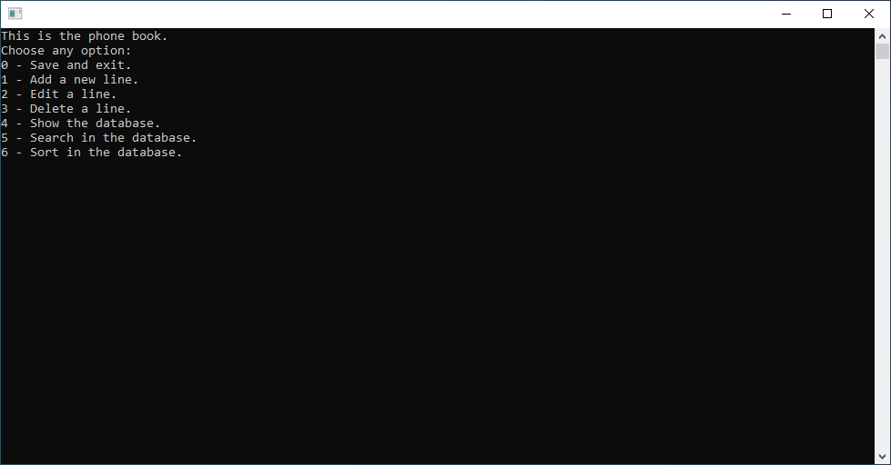
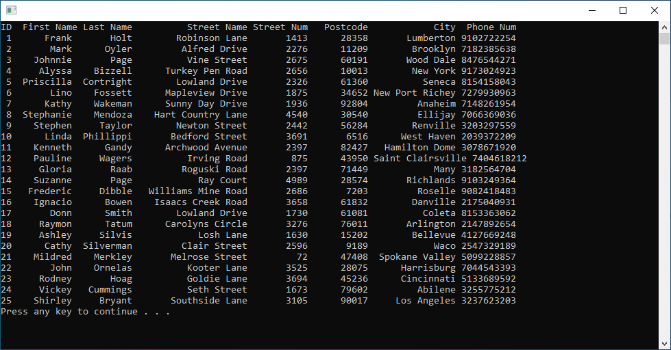
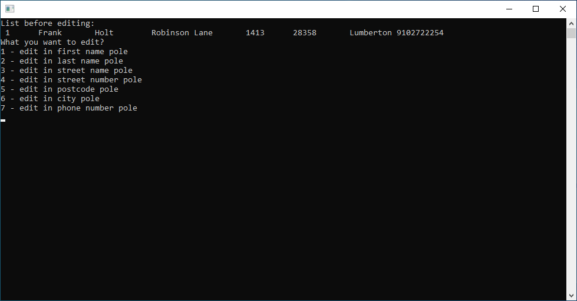
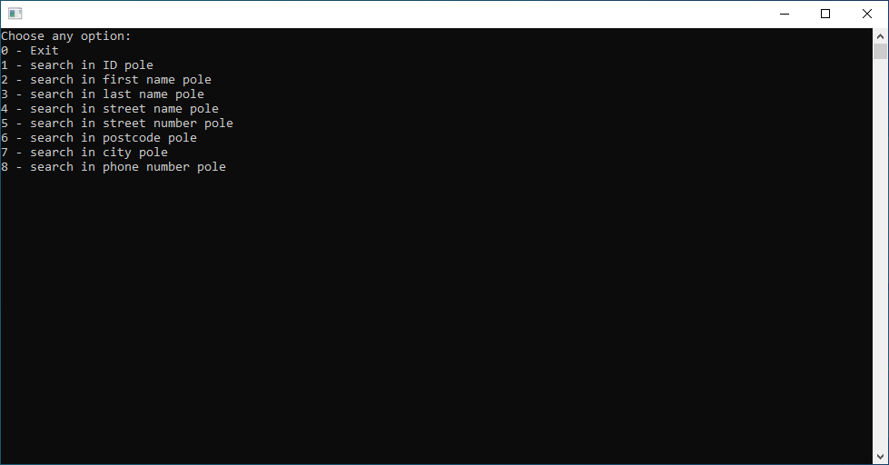
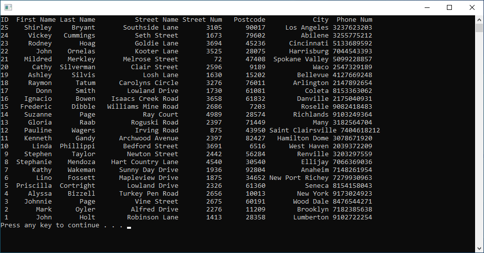

# Phone Book / Książka Telefoniczna

## EN

### Overview

Phone Book is a console-based contact management application written in C as a first-year university project at Kielce University of Technology.
The program allows users to manage a phone book containing contact information, including first name, last name, address, and phone number. Contacts are stored in a linked list and can be loaded from and saved to a text file.
The application provides basic contact management features, such as adding, editing, deleting, displaying, searching, and sorting records. Each contact is assigned an ID, which can be used to identify a record when editing or deleting it.

### Features

- Add new contacts to the phone book.
- Edit selected contact fields using the contact ID.
- Delete contacts by ID.
- Display all stored contacts.
- Search for contacts by a selected field.
- Sort contacts by ID in ascending or descending order.
- Load contact data from a text file.
- Save contact data to `data.txt`.
- Manage contact records using a linked list.

### Screenshots

### Technologies

- C
- Standard C libraries: `stdio.h`, `stdlib.h`, `string.h`
- Windows API: `windows.h`
- Text file storage

## PL

### Opis

Phone Book to konsolowa aplikacja do zarządzania kontaktami, napisana w języku C w ramach projektu realizowanego na pierwszym roku studiów na Politechnice Świętokrzyskiej.
Program umożliwia prowadzenie książki telefonicznej zawierającej dane kontaktowe, takie jak imię, nazwisko, adres oraz numer telefonu. Kontakty są przechowywane na liście jednokierunkowej i mogą być wczytywane z pliku tekstowego oraz zapisywane do pliku.
Aplikacja oferuje podstawowe funkcje zarządzania kontaktami: dodawanie, edytowanie, usuwanie, wyświetlanie, wyszukiwanie oraz sortowanie rekordów. Każdy kontakt posiada identyfikator ID, który umożliwia wskazanie odpowiedniego rekordu podczas edycji lub usuwania.

### Funkcjonalności

- Dodawanie nowych kontaktów do książki telefonicznej.
- Edytowanie wybranych pól kontaktu na podstawie jego ID.
- Usuwanie kontaktów według ID.
- Wyświetlanie wszystkich zapisanych kontaktów.
- Wyszukiwanie kontaktów według wybranego pola.
- Sortowanie kontaktów według ID rosnąco lub malejąco.
- Wczytywanie danych kontaktowych z pliku tekstowego.
- Zapisywanie danych do pliku `data.txt`.
- Zarządzanie rekordami za pomocą listy jednokierunkowej.

### Screeny

### Technologie

- C
- Standardowe biblioteki języka C: `stdio.h`, `stdlib.h`, `string.h`
- Windows API: `windows.h`
- Przechowywanie danych w pliku tekstowym
